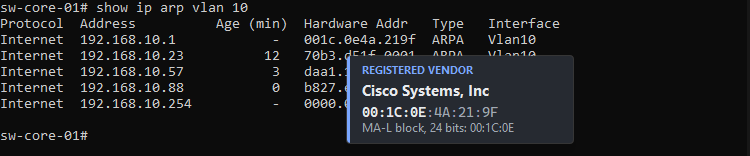
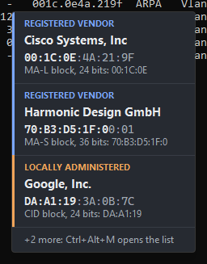
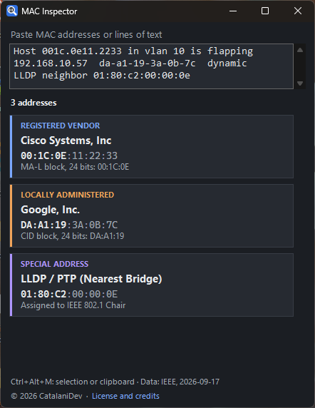

<p align="center">
  
</p>

<h1 align="center">MAC Inspector for Windows</h1>

<p align="center">
  <strong>English</strong> · <a href="README.it.md">Italiano</a>
</p>

<p align="center">
  <strong>Hover over a MAC address in any app, see who made the device.</strong><br>
  Consoles, terminals, Notepad, Office, browsers, or any text you copy: the vendor is shown next to the cursor.
</p>

<p align="center">
  
  
  
  
</p>



MAC Inspector for Windows brings the [MAC Inspector Chrome extension](https://github.com/catalani-dev/mac-inspector) to the whole desktop. It uses the same IEEE registry and gives the same results.

## Features

- **Vendor on hover.** Rest the mouse on a MAC address and a card shows the manufacturer, with the vendor prefix in bold. It works in applications that expose their text to Windows accessibility (see [Where hover works](#where-hover-works)).
- **Copied text.** Copy any text that contains MAC addresses, in any application, and a card lists them. This covers SSH clients, remote desktops and editors where hover is not possible.
- **Ctrl+Alt+M.** Identifies the selected text or, if nothing is selected, the clipboard.
- **Search window.** Paste log lines, ARP tables or a bare prefix such as `B8-27-EB`; every address found is listed. One click copies MAC and vendor.
- **Complete IEEE registry.** MA-L, MA-M, MA-S, IAB and CID blocks with longest-prefix matching.
- **Colour-coded address types.**

  | Colour | Address type |
  |---|---|
  | Blue | Registered vendor |
  | Orange | Random or virtual MAC (locally administered) |
  | Purple | Group or special address |
  | Grey | Not registered |

- **Special addresses.** Broadcast, IPv4 and IPv6 multicast, STP, LACP, LLDP, CDP, PVST+, VRRP and HSRP.
- **Notations.** `00:1C:0E:11:22:33`, `00-1C-0E-11-22-33`, `001c.0e11.2233` (Cisco), `001c-0e11-2233` (Huawei / H3C), `001c0e-112233` (HP / Aruba), `001C0E112233`.
- **English and Italian**, light and dark theme following Windows, sharp on high-DPI and multi-monitor setups.
- **Nothing to install.** One folder, started by a script; it uses only components that ship with Windows.

| Copied text | Search window |
|---|---|
|  |  |

## Where hover works

Hover reads the text under the cursor through Windows UI Automation, the interface used by screen readers. Measured on Windows 11, with a control point next to every address (on the IP of the same line) to check for false results:

| Application | Addresses recognised | False results |
|---|---|---|
| Command Prompt (classic console) | 6 of 6 | 0 |
| Windows Terminal | 6 of 6 | 0 |
| Notepad | 6 of 6 | 0 |
| Microsoft Word | 6 of 6 | 0 |
| Microsoft Excel | 3 of 3 | 0 |
| Google Chrome (web pages) | 4 of 4 | 0 |

Each lookup took less than 100 ms (between 10 and 82 ms).

Applications that draw their own text without exposing it, such as the VS Code editor, most SSH clients (PuTTY and similar) and remote desktop sessions, cannot be read on hover. There, copy the text or press **Ctrl+Alt+M** on the selection. Screen text recognition (OCR) is deliberately not used: the OCR built into Windows read 0 of 10 MAC addresses correctly in tests, confusing `0` with `e` and splitting addresses at the colons.

## Installation

1. **Download.** Open the [latest release](https://github.com/catalani-dev/mac-inspector-windows/releases/latest) and download `mac-inspector-windows-<version>.zip` from **Assets**.
2. **Unblock.** Right-click the ZIP, choose **Properties**, tick **Unblock** and click **OK**. Windows marks downloaded files, and unblocking the ZIP before extracting avoids security prompts for every file.
3. **Extract** it to a permanent folder, for example `Documents\mac-inspector-windows`.
4. **Start** it with a double click on `Start-MAC-Inspector.cmd`. The magnifying glass icon appears in the notification area, next to the clock; the first start shows a short welcome notification.

Requires Windows 10 or 11 with Windows PowerShell 5.1 and .NET Framework 4.x, which are part of Windows. No administrator rights are needed.

The program is started from its readable source: `MAC-Inspector.ps1` compiles `MacInspector.cs` with the C# compiler built into Windows (about one second) and runs it. Nothing is installed and no executable is downloaded.

**Start with Windows.** Press **Win+R**, type `shell:startup` and press Enter, then create in that folder a shortcut to `Start-MAC-Inspector.cmd`.

**Updating.** Choose **Exit** from the icon menu, replace the files in the folder with those of the new release, and start it again. Settings are kept.

**Removing.** Choose **Exit** from the icon menu and delete the folder. Settings are in `%APPDATA%\MAC Inspector Desktop`, which can be deleted too.

## How it works

1. **Hover.** Rest the mouse on a MAC address for a moment. A card appears below it with the address type, the manufacturer, the address with the vendor prefix in bold, and the registry block that matched. Move away and it disappears.
2. **Copy.** Copy text that contains MAC addresses. A card lists up to three of them; the rest are counted, and **Ctrl+Alt+M** opens the full list.
3. **Select and press Ctrl+Alt+M.** The selected text is read; if nothing is selected, the clipboard is used. Without any MAC address, the search window opens.
4. **Search.** Click the icon, paste text, read the results. A click on a card copies `MAC<TAB>vendor`.

Nothing is sent anywhere: the lookup uses the copy of the IEEE registry in the program folder.

## Usage

Right-click the icon in the notification area:

| Menu item | Effect |
|---|---|
| **Search…** | Opens the search window (also a left click on the icon) |
| **Show vendor on hover** | Turns hover cards on or off |
| **Identify copied MAC addresses** | Turns cards for copied text on or off |
| **Language** | Automatic (follows Windows), English or Italiano |
| **License and credits** | Version, copyright, license and data source |
| **Exit** | Closes MAC Inspector |

| Shortcut | Action |
|---|---|
| `Ctrl+Alt+M` | Identify the selection or the clipboard |
| `Esc` | Close the search window |

If another program already uses Ctrl+Alt+M, MAC Inspector says so at start and the search window remains available from the icon.

Starting `Start-MAC-Inspector.cmd` again while MAC Inspector is running opens the search window. `MAC-Inspector.ps1 -Exit` closes the running instance, for scripts and updates.

## Privacy and security

- **Everything runs locally.** No network connections, no analytics, no external services.
- **Read-only.** MAC Inspector reads text through the accessibility interface and the clipboard; it never types, clicks or changes anything in other applications.
- **Password fields are never read**, on hover or with Ctrl+Alt+M.
- **Private clipboard content is skipped.** Password managers mark copied secrets as excluded from clipboard monitoring (`ExcludeClipboardContentFromMonitorProcessing`); such content is not read.
- **Nothing is stored** except the settings file. Text is only searched for MAC addresses in memory; the list of recent addresses is lost when the program closes. Copied-text cards can be turned off in the menu.
- **No administrator rights and no installation.** The source is plain text you can read before running it; it is compiled on your computer.
- **Execution policy.** The start script runs PowerShell with `-ExecutionPolicy Bypass` for this process only. The system setting is not changed.

## Updating the IEEE registry

`oui-data.json` is the same file used by the [Chrome extension](https://github.com/catalani-dev/mac-inspector), built by its `build-oui-database.py` from the IEEE registries. To update it, copy the newer `oui-data.json` from that repository (or build it with the script) into this folder, then exit and start MAC Inspector again. The data date is shown at the bottom of the search window.

## Development

| File | Purpose |
|---|---|
| `MacInspector.cs` | The program: MAC detection, registry lookup, UI Automation reading, cards, search window, icon menu |
| `MAC-Inspector.ps1` | Compiles `MacInspector.cs` and starts it; `-Exit` closes the running instance |
| `Start-MAC-Inspector.cmd` | Starts the program without a console window |
| `oui-data.json` | IEEE registry data (third-party data, see [NOTICE.md](NOTICE.md)) |
| `mac-inspector.ico` | Program icon |
| `tests/` | Automated tests |
| `docs/img/` | Logo, screenshots and social preview image used on GitHub |

Run the tests with:

```bash
powershell -NoProfile -ExecutionPolicy Bypass -File tests\Test-Core.ps1
```

`tests/vectors.json` holds the results of the Chrome extension's `mac-core.js` and `i18n.js` for the same inputs and the small registry in `tests/fixture-oui.json`. The test checks that detection, lookups and texts in English and Italian are identical, and that the bundled registry loads correctly.

Setting the environment variable `MACI_TEST_LOG` to a file path makes the program write its events (cards shown and hidden, searches, hotkey) to that file, for end-to-end tests.

Every source file starts with an [SPDX](https://spdx.dev/) header that identifies the copyright holder and the license.

## License

Copyright (c) 2026 CatalaniDev. Released under the **MAC Inspector License 1.0**, the same license as the Chrome extension. This is a source-available license, not an open source license. The full terms are in [LICENSE](LICENSE).

| | |
|---|---|
| **Allowed** | Read the code; use MAC Inspector personally or inside your organisation, including at work; modify it for your own use. |
| **Allowed with credit** | Include MAC Inspector, modified or not, in your own **free, non-commercial** tool, as long as that tool adds substantial functionality and you keep the credits (below). |
| **Requires written permission** | Including MAC Inspector in a **commercial** product or service (paid, subscription, paid tier, paid online service, bundled with paid offerings, or ad-supported); redistributing it on its own; publishing it or a clone in a store or distribution channel; selling it on its own; removing copyright notices. |

### Including MAC Inspector in your tool

**Commercial products.** If your product or service makes money in any way, write to <catalanidev@gmail.com> before including MAC Inspector. Permission is granted case by case.

**Free, non-commercial tools.** Follow these steps:

1. Keep the SPDX header in every file you reuse.
2. Ship a copy of [LICENSE](LICENSE) or a link to it.
3. Credit it in your documentation and in your "About" or "Credits" section:

   ```text
   Includes MAC Inspector, Copyright (c) 2026 CatalaniDev,
   used under the MAC Inspector License 1.0.
   ```

4. Say so if you modified the code.
5. Do not name your tool "MAC Inspector" or imply endorsement by the author.
6. If you reuse the search window or the About dialog, keep the "© 2026 CatalaniDev" line and its "License and credits" link visible.

The IEEE registry data and the trademarks mentioned belong to their respective owners and are not covered by this license: see [NOTICE.md](NOTICE.md). MAC Inspector is not affiliated with or endorsed by the IEEE, Microsoft or Google.

## Author

**CatalaniDev**, <catalanidev@gmail.com>

For permissions beyond the license, feedback or bug reports, write to the address above.
